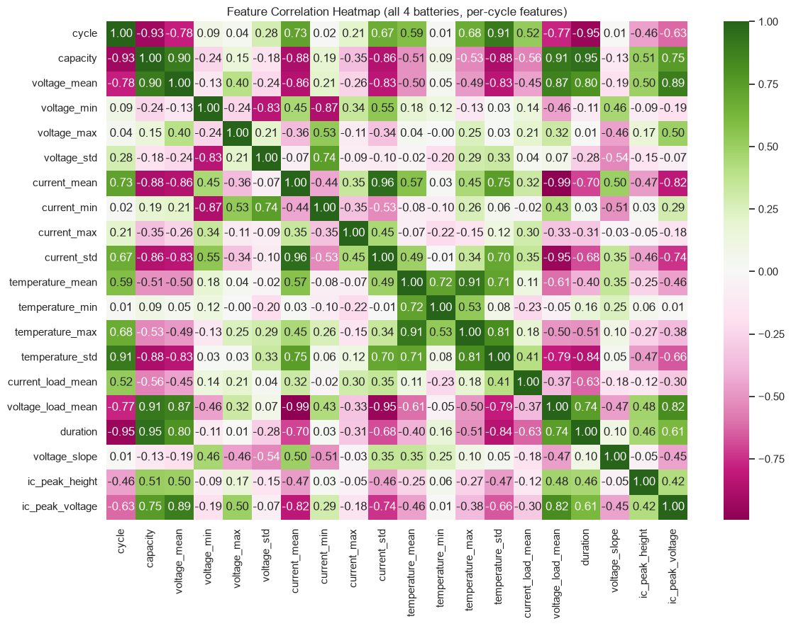
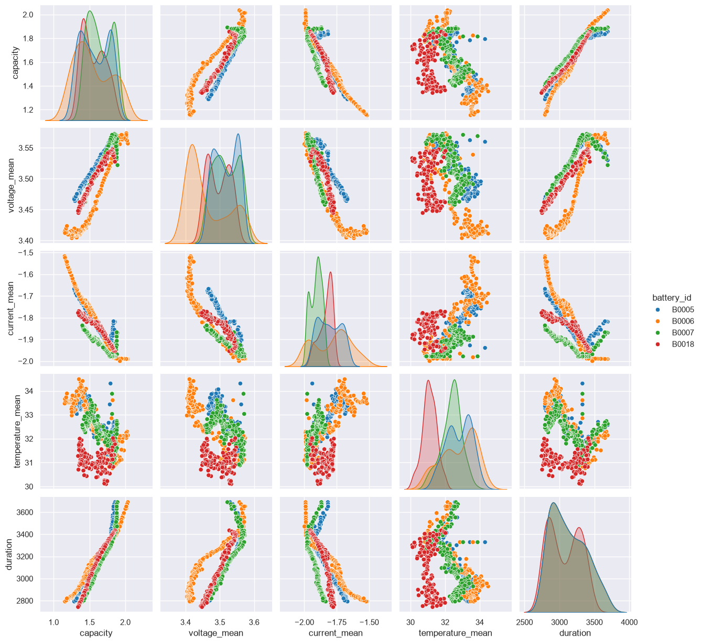

# Li-Ion Battery State of Health (SOH) Prediction for EVs

Predicting Li-ion battery capacity degradation from charge/discharge cycling data, using the NASA Prognostics Center of Excellence (PCoE) Battery Dataset. Built as a regression problem — not classification — with per-battery leave-one-out validation to keep the evaluation honest.

## Problem Statement

As a Li-ion cell ages, its usable capacity fades cycle over cycle. **State of Health (SOH)** — capacity at a given cycle as a percentage of the cell's initial (rated) capacity — is the standard metric used to track this degradation, and it underpins real EV Battery Management System (BMS) decisions: charge scheduling, fast-charge current limits, and end-of-life flagging.

This project builds a regression pipeline that predicts SOH directly from per-cycle electrical and thermal signals (voltage, current, temperature), without relying on the cell's full historical capacity trace — i.e., it estimates health from a single cycle's sensor readings.

## Dataset

**NASA PCoE Li-ion Battery Dataset** — four cells (B0005, B0006, B0007, B0018) run through repeated charge/discharge/impedance cycles at room temperature (24°C) until end of life.

- Raw data: per-cycle time series of measured voltage, current, temperature, load current, and load voltage during discharge (~50,000+ raw readings per cell).
- Aggregated to **636 cycle-level records** across all four cells (one row per battery per cycle).
- End-of-life (EOL) criterion: **SOH ≤ 70%**, per the dataset's own documentation.

> Saha, B. & Goebel, K. (2007). _Battery Data Set_, NASA Prognostics Data Repository, NASA Ames Research Center, Moffett Field, CA.

## Project Structure

```
.
├── data/                       # raw NASA .mat files (B0005.mat, B0006.mat, B0007.mat, B0018.mat) and README.txt
├── src/                        # processed, cycle-level CSVs
│   ├── battery_cycle_data.csv  # output of exploratory_analysis.ipynb
│   └── final_data.csv          # output of feature_engineering.ipynb
├── notebooks/
│   ├── exploratory_analysis.ipynb   # .mat parsing, aggregation, EDA
│   ├── feature_engineering.ipynb    # SOH/RUL labeling, derived features
│   └── model_training.ipynb         # model comparison, leave-one-battery-out CV
└── README.md
```

## Workflow

**1. Exploratory Analysis** (`exploratory_analysis.ipynb`)
Parses the raw `.mat` files for all four cells, isolates discharge cycles, and aggregates each cycle's raw measurement stream into summary statistics (mean/min/max/std of voltage, current, temperature; load current and load voltage means; cycle duration). Includes capacity-fade-over-cycles visualization, distribution checks, and a correlation heatmap across the engineered fields.

**2. Feature Engineering** (`feature_engineering.ipynb`)

- Computes **SOH** per row as `100 × (capacity / first-cycle capacity)` for each battery.
- Derives **RUL** (Remaining Useful Life) as cycles remaining until SOH crosses the 70% EOL threshold.
- Adds `cycle_normalized` (cycle position scaled within each battery's own lifespan), `voltage_range`, and `temperature_range`.
- Validates there are no missing values in any of the core feature columns.

**3. Model Training** (`model_training.ipynb`)
Trains and compares four regressors on the SOH prediction task:

| Model                       | Notes                                                   |
| --------------------------- | ------------------------------------------------------- |
| Linear Regression           | baseline                                                |
| Decision Tree Regressor     | `max_depth=5`, `min_samples_leaf=3`                     |
| Random Forest Regressor     | `n_estimators=200`                                      |
| Gradient Boosting Regressor | `n_estimators=100`, `learning_rate=0.05`, `max_depth=3` |

**Validation strategy:** leave-one-battery-out cross-validation — each of the four cells is held out as the test set in turn, with the model trained on the remaining three. This avoids the leakage risk of a random or in-cell split, since consecutive cycles from the same battery are highly correlated.

**Features used (19):** `cycle`, `cycle_normalized`, `voltage_mean/min/max/std`, `voltage_range`, `current_mean/min/max/std`, `temperature_mean/min/max/std`, `temperature_range`, `current_load_mean`, `voltage_load_mean`, `duration`.

## Results

Correlation between various features across the 4 batteries:





Average performance across all four held-out batteries:

| Model                 | MSE       | R²        |
| --------------------- | --------- | --------- |
| **Gradient Boosting** | **17.98** | **0.865** |
| Random Forest         | 19.77     | 0.850     |
| Decision Tree         | 24.83     | 0.802     |
| Linear Regression     | 24.10     | 0.760     |

Gradient Boosting gives the best average fit, but performance is not uniform across cells — R² ranges from 0.94–0.97 on B0005/B0007 down to ~0.60 on B0006, indicating the model generalizes less well to cells with different degradation behavior than it does within similar ones.

## Limitations

- Only 4 cells, all cycled under the same ambient temperature (24°C) — the model hasn't been tested against different chemistries, temperatures, or usage profiles, so generalization beyond this dataset is unverified.
- RUL/EOL labels are undefined for cells whose SOH never dropped to the 70% threshold within their recorded cycle range (300 of 636 rows) — RUL is currently derived as a feature but not yet used as a modeling target because of this gap.
- Gradient Boosting's higher average score is partly driven by strong fits on two of the four cells; the B0006 result suggests the current feature set doesn't fully capture what differs about that cell's degradation.

## References

- Zheng, L., Zhang, L., Zhu, J., Wang, G. & Jiang, J. Co-estimation of state-of-charge, capacity and resistance for lithium-ion batteries based on a high-fidelity electrochemical model. Appl. Energy 180, 424–434. https://doi.org/10.1016/j.apenergy.2016.08.016 (2016).

- Li, S., He, H., Su, C. & Zhao, P. Data driven battery modeling and management method with aging phenomenon considered. Appl. Energy 275, 115340. https://doi.org/10.1016/j.apenergy.2020.115340 (2020).

## Future Work

- Train RUL as a direct regression target on the subset of cells with valid EOL labels.
- Domain-derived features (incremental capacity analysis / dQ-dV peaks, internal resistance trend from impedance cycles) to better explain the B0006 gap.
- A rule-based charging/BMS advisory layer on top of SOH predictions.

## To run the streamlit app locally (install the uv package manager)
- uv init
- uv venv (then activate your virtual python environment)
- uv add -r requirements.txt
- streamlit run app.py